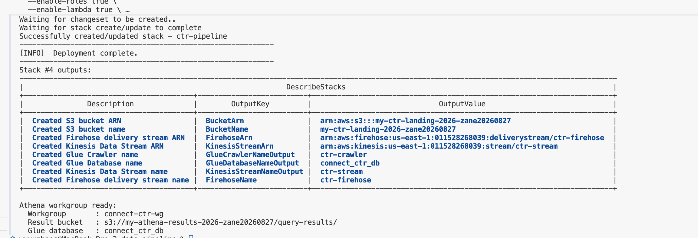

# Amazon Connect Data Pipeline — Deployment Toolkit

Infrastructure-as-Code toolkit for provisioning and operating a full Amazon Connect **CTR (Contact Trace Record) data pipeline** on AWS. Four CloudFormation templates plus one shell orchestrator deploy every layer of the stack — IAM, the cleaning Lambda, the Glue + Athena analytics layer, and the streaming pipeline itself — in a repeatable, script-driven way.

---

## Why this toolkit exists

Standing up a Connect data pipeline by hand means clicking through Kinesis, Firehose, IAM, S3, Glue and Athena in the console, in an order that is easy to get wrong. IAM alone is the single most common failure point. This toolkit turns the whole process into:

```bash
./deploy_pipeline.sh --pipeline ctr --stack ctr-pipeline …
```

- **Repeatable** across environments and regions
- **Modular** — base infrastructure (roles, Lambda, database) is decoupled from the pipeline itself, so you can iterate on the pipeline without touching IAM
- **Auditable** — the shell script prints a full preview and prompts for confirmation before any resource is created

---

## Architecture

```
Amazon Connect
      │  (CTR streaming enabled)
      ▼
Kinesis Data Stream ──► Kinesis Firehose ──► [ Lambda transform (optional) ] ──► S3 landing bucket
                                                                                       │
                                                                                       ▼
                                                                                Glue Crawler
                                                                                       │
                                                                                       ▼
                                                              Glue Database ◄── Athena Workgroup
                                                                                (query results → S3)
```

Every arrow above is provisioned by one of the four templates in this directory.

---

## Files in this directory

| File | What it deploys | Depends on |
|---|---|---|
| `pipeline_roles.yaml` | Firehose IAM role, Glue Crawler IAM role | — |
| `clean_ctr_lambda.yaml` | Cleaning Lambda + its execution role (Python 3.12, inline code) | — |
| `glue_athena.yaml` | Glue Database, Athena Workgroup, query-result S3 bucket (7-day lifecycle) | — |
| `data_pipeline.yaml` | S3 landing bucket, Kinesis stream, Firehose delivery stream, Glue Crawler | roles ± lambda ± database |
| `deploy_pipeline.sh` | Orchestrator that deploys the four templates in order | AWS CLI |

---

## Deployment model

The four templates are deployed as **four independent stacks**. The first three are optional (enabled by flags); the fourth always runs and looks up the ARNs of the resources it needs by **name**.

```
Step 1  pipeline_roles.yaml       ──► CFN stack: <pipeline>-roles         (--enable-roles true)
Step 2  clean_ctr_lambda.yaml     ──► CFN stack: <pipeline>-lambda        (--enable-lambda true)
Step 3  glue_athena.yaml          ──► CFN stack: <pipeline>-glue-athena   (--enable-glue-athena true)
Step 4  data_pipeline.yaml        ──► CFN stack: <your --stack name>      (always)
```

**Why four stacks?**

- **Blast radius**: an accidental change to `data_pipeline.yaml` cannot touch IAM.
- **Iteration speed**: after the first successful deploy, day-to-day updates only redeploy stack #4.
- **Reusability**: the same roles/database/Lambda can serve multiple pipelines (e.g. `ctr`, `agent`, `lens`) — just deploy stack #4 more than once with different names.

**Firehose Lambda transformation is attached only when both:**
- `--enable-lambda true`
- `--lambda <name>` is provided

Any other combination deploys the Firehose stream **without** any Lambda processor.

---

## Prerequisites

- AWS CLI configured (`aws sts get-caller-identity` returns your account)
- The four YAML templates present in the current directory
- `chmod +x deploy_pipeline.sh` (first time only)

---

## First-time full deployment

Deploy every layer:

```bash
./deploy_pipeline.sh \
  --pipeline ctr \
  --stack ctr-pipeline \
  --enable-roles true \
  --enable-lambda true \
  --enable-glue-athena true \
  --firehose-role connect-data-pipeline-firehose-role \
  --crawler-role connect-data-pipeline-crawler-role \
  --lambda connect-clean-ctr-data \
  --lambda-role connect-clean-ctr-data-role \
  --database connect_ctr_db \
  --workgroup connect-ctr-wg \
  --athena-result-bucket my-athena-results-<unique-suffix> \
  --bucket my-ctr-landing-<unique-suffix> \
  --stream ctr-stream \
  --firehose-stream ctr-firehose \
  --crawler ctr-crawler \
  --region us-east-1
```

S3 bucket names are globally unique — pick a suffix that only you will use.

The script prints a full preview and asks `Proceed with deployment? [y/N]:`.
Type `y` to run all four steps in order.

## Subsequent iterations on the pipeline only

Drop the three enable flags. The three base stacks are skipped; only `data_pipeline.yaml` is redeployed:

```bash
./deploy_pipeline.sh \
  --pipeline ctr \
  --stack ctr-pipeline \
  --firehose-role connect-data-pipeline-firehose-role \
  --crawler-role connect-data-pipeline-crawler-role \
  --lambda connect-clean-ctr-data \
  --database connect_ctr_db \
  --bucket my-ctr-landing-<unique-suffix> \
  --stream ctr-stream \
  --firehose-stream ctr-firehose \
  --crawler ctr-crawler \
  --region us-east-1
```

The script still looks up the Firehose and Crawler role ARNs (and the Lambda ARN if `--lambda` is given) by name and passes them to stack #4.

Run `./deploy_pipeline.sh -h` for the full option list.

---

## What the orchestrator does in step 4

Beyond the CFN deploy itself, the script performs two lookup + two IAM patches:

1. `aws iam get-role` for Firehose and Crawler role ARNs.
2. `aws lambda get-function` for the Lambda ARN (only when both attach conditions hold).
3. Puts a bucket-scoped inline `s3:PutObject / AbortMultipartUpload / …` policy onto the Firehose role, named `DataPipelineFirehoseS3-<pipeline>`.
4. Puts a bucket-scoped inline `s3:GetObject / ListBucket` policy onto the Crawler role, named `DataPipelineCrawlerS3-<pipeline>`.

The bucket-scoped policies live outside `pipeline_roles.yaml` because the bucket name is only known at stack #4 time.

---

## Verification checklist

After a successful run:

- [ ] Bind the Kinesis stream to your Connect instance (Data Storage → CTR streaming → select `<stream>`)
- [ ] Place a test call and wait for the Firehose buffer to flush (5 min default)
- [ ] Confirm objects appear under `s3://<bucket>/`
- [ ] Download one, `gunzip` it, and verify each JSON record has an `attributes_clean` field (proof the Lambda ran)
- [ ] In Glue, run the Crawler once; it will create a table in `<database>`
- [ ] In Athena, select workgroup `<workgroup>` and run `SELECT * FROM <database>.<table> LIMIT 10;`

---

## Example output

The script prints a preview and, on success, a table of stack #4 outputs and the Athena workgroup summary:



---

## Design notes

- **Firehose Processors** — the delivery stream runs `AppendDelimiterToRecord` and, when enabled, the Lambda transform. Order in the CFN `Processors` array is not authoritative for `AppendDelimiterToRecord`; Firehose applies the delimiter at S3 write time regardless.
- **`AWS::NoValue` in `!If`** — used inside the Firehose processor list so the Lambda entry disappears entirely (not `null`) when transformation is off.
- **Firehose external-ID condition** — the Firehose role's trust policy requires `sts:ExternalId = <account-id>` to prevent confused-deputy misuse.
- **Athena workgroup `EnforceWorkGroupConfiguration: true`** — client-side query-result settings are ignored; every query lands in the query-result bucket declared in stack #3.
- **Bucket lifecycle** — the Athena query-result bucket expires objects after 7 days.
- **Retention** — both S3 buckets are `Retain` on stack delete so data is never lost by an accidental `delete-stack`.

## Known gap

The bucket-scoped inline policies attached in step 4 are **not owned by the CFN stack** — deleting stack #4 does not remove them. They can be folded back into `data_pipeline.yaml` as `AWS::IAM::Policy` resources so that stack teardown is fully clean; see the comments in `deploy_pipeline.sh` for context.
